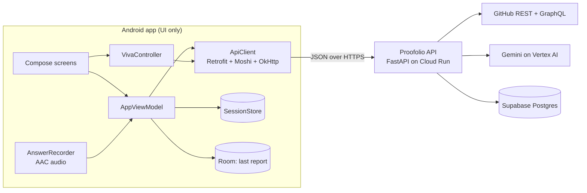

# Proofolio for Android

**Internships matched on skill a student has shown, not skill they have claimed.**


-3DDC84?logo=android&logoColor=white)


This is the Android student app of Proofolio. A student picks one of their own GitHub repos and answers 5 questions about specific lines of that code, by voice or typing, in any language. Their answers become a skill report where every score comes with evidence, and internships are matched on those verified skills only.

Tri-City AI-Thon 2026 · Promtal track · Problem statement: *Match students with internships based on skills, interests and hackathon performance.*

| | |
|---|---|
| This repo | The Android app (Kotlin, Jetpack Compose) |
| Student web app (the same product in a browser) | https://verifiedbuild-api-215071922486.asia-south1.run.app/app/ |
| Recruiter dashboard (web, needs the admin passcode; ask us) | https://verifiedbuild-api-215071922486.asia-south1.run.app/recruiter/ |
| Live API and its docs | https://verifiedbuild-api-215071922486.asia-south1.run.app/docs |
| API and web source | [samarthputhraya/verifiedbuild-api](https://github.com/samarthputhraya/verifiedbuild-api) (private during judging; ask us for access) |

The product was called VerifiedBuild until 11 Oct 2026. The API's URL and a few class names (`VerifiedBuildApi`, `VerifiedBuildApp`) keep the old name because the app was built against them.

---

## The problem

AI lets anyone ship a polished project in an afternoon. So a repo, a resume keyword or a hackathon result no longer tells a recruiter whether the student understands what they built. Students who can really build get filtered out with everyone else, and recruiters spend screening time on people who can't explain their own project.

Proofolio asks the one question that matters: *can you explain your own code?* Using AI to build is fine. We don't guess who wrote the code; we check understanding, and keep the evidence.

## What the app does

The student path, about 8 minutes from sign-up to applying:

| Step | What the student sees | Screen |
|---|---|---|
| 1. Create a profile | Name, email, college and GitHub username. Skills come from a resume PDF (read by the API) or from 25 skill chips. Pick interests from 12. Agree to the privacy policy and terms. | `StudentOnboardingScreen.kt` |
| 2. Pick a repo | Their public, non-fork repos, newest first. Or **Verify a team repo** by typing `owner/repo` for a team or organisation repo they committed to. | `RepoPickerScreen.kt` |
| 3. Wait while the API reads it | "Reading *repo* and writing 5 questions about your code", usually 15–30 seconds. Cancel at any time. | `AnalyzingScreen.kt` |
| 4. See what was read | Files read, code languages, and on a team repo, the student's commits and the files they changed. | `RepoFoundScreen.kt` |
| 5. Answer 5 questions | Each question shows the file, the line range and the code with line numbers. 90 seconds each. Speak or type in any language. A weak answer gets one follow-up ("One more chance on this question"). No score is shown during the viva. | `VivaScreen.kt` |
| 6. Read the report | Overall verified score, a radar of the 6 skills (Backend, Frontend, Data, AI/ML, DevOps, Security) with a level for each, **You said / You showed** (claimed skills next to verified ones), every answer with what it covered and missed next to the code, and how the repo was built (from GitHub, never part of the score). | `ReportScreen.kt` |
| 7. Apply | Internships ranked by match, each with a one-line reason. Applying opens a consent dialog that names the company, and only that recruiter sees the report. | `ReportScreen.kt`, `StudentDashboardScreen.kt` |
| 8. Add hackathons | Event, year, result, team size and the project repo. An entry stays **Not verified yet** until the student finishes a viva on that repo; then it counts toward matches. | `AddHackathonSheet.kt`, `VivaCompleteScreen.kt` |

A student can close the app mid-viva and continue later from the dashboard ("Continue viva (2 of 5)"): the server keeps every answer.

## How it works



**The app holds no API keys and never calls Gemini or GitHub.** Every question, score and match comes from the Proofolio API, so this app, the web app and the recruiter dashboard all show the same data. On the server:

- **Questions are about real code.** Gemini writes 5 questions (2 easy, 2 medium, 1 hard) about real line ranges. The API checks every file and line range exists and cuts the snippet from the real file itself.
- **Answers are scored against a rubric the student never sees.** Each answer gets 0–10 against 3–4 private rubric points and the code, with a word-for-word quote from the answer as evidence. Language, accent and grammar don't count.
- **The match has no AI in it:** `match = 60% verified skill fit + 25% shared interests + 15% best verified hackathon`. Claimed skills and unverified hackathons count for nothing.

### API endpoints the app calls

| Endpoint | Used for |
|---|---|
| `GET /api/health` | Checking the server at launch |
| `POST /api/students` | Creating the profile (resume PDF sent as base64) |
| `GET /api/github/{username}/repos` | The repo list |
| `POST /api/analyze` | Reading a repo; returns the 5 questions and a viva session |
| `POST /api/viva/{session_id}/answer` | Sending a typed or spoken answer |
| `GET /api/viva/{session_id}` | Continuing a viva after the app was closed |
| `GET /api/report/{student_id}` | The report, matches and hackathons |
| `GET /api/listings` | Internship details on the report |
| `POST /api/apply` | Applying with consent |
| `POST /api/students/{student_id}/hackathons` | Adding a hackathon |
| `DELETE /api/students/{student_id}/hackathons/{hackathon_id}` | Removing one |

The app never calls the recruiter routes (`/api/admin/*`).

### Details that make it work on a real phone

- **Voice answers.** `AnswerRecorder` records mono AAC in an `.m4a` file (44.1 kHz, 64 kbps), sends it as base64 inside JSON, and deletes the file. The API converts it with ffmpeg and transcribes it, so Hindi, Telugu and mixed-language answers work the same as English. A recording under about a second is rejected on the phone ("That recording was too short"). If microphone access is off, the screen switches to typing.
- **Timer.** Each question has the API's time limit (90 s). At zero, a recording in progress stops but is kept: "Time's up. Submit what you have."
- **Typed answers.** Up to 6,000 characters. If 25 or more characters arrive at once, the answer is sent with `pasted: true`. Recruiters see that as a plain fact; it never changes the score.
- **Errors in plain English.** The API returns every error as `{"error": {"code", "message"}}`. `ApiClient` turns it into `ApiResult.Err`, and the screen shows the message exactly as written. Network failures and unexpected responses get their own plain messages. **Retry** is offered only where sending the same answer again can work (AI timeout, network, server errors).
- **Double taps.** A second submit is ignored while one is on its way. If the server says the answer already arrived (`ALREADY_ANSWERED`), the viva reloads from the server instead of failing.
- **Slow calls.** Reading a repo can take up to a minute, so OkHttp allows 15 s to connect, 120 s to read and 150 s per call.
- **Resume check before upload.** The picked file must be a PDF, under 5 MB, and start with `%PDF`. The phone never reads its content; the API does.
- **Offline.** The last report is saved in Room and shown if the server can't be reached.

### Tested against the live API

The seven files that talk to the API (`ApiModels.kt`, `VerifiedBuildApi.kt`, `ApiClient.kt`, `SessionStore.kt`, `ResumePicker.kt`, `AnswerRecorder.kt`, `VivaController.kt`) were written first in the API repo (`clients/android/`) and tested there. They compile against Android 15 with Kotlin 2.2.10, and a test harness ran them against the live API with real GitHub and Gemini: sign-up, analyze, a voice answer sent as AAC, follow-ups, continuing a viva from a second instance, a repeated submit, adding, verifying and removing a hackathon, applying, and every error case.

Five of the seven are identical here. `ApiClient.kt` differs by one comment, and `VivaController.kt` adds the Skip actions (see [Known limitations](#known-limitations)).

Every change made in AI Studio follows [PROJECT_RULES.md](PROJECT_RULES.md): never invent data or fallback scores, show the API's messages as written, never show a score or rubric during the viva, and treat "pasted" and build history as neutral facts.

## What's live and what's sample

- **Student** on the Get Started screen is the live path. Every screen after it uses the live API.
- **Explore Demo**, **Admin** and **Recruiter** open a demo mode for judges: a 7-step guided tour (student profile → repository → interview → assessment → admin review → feedback → recruiter view) or free browsing. It runs on the phone only, with fictional people and fixed sample data (`DemoFixtures.kt`, `DemoData.kt`), shows a **DEMO MODE ACTIVE** banner on every screen, and never calls the server. Some of its screens sketch ideas that aren't in the live product (for example CGPA and admin feedback); where they differ, the live app is what counts.
- **Recruiters** use the [web dashboard](https://verifiedbuild-api-215071922486.asia-south1.run.app/recruiter/), not this app. It shows a live shortlist per internship, ranked by verified match, with each answer next to the code it was about, and a CSV export.

## Privacy

- Students opt in at sign-up. Their report stays private until they apply.
- Applying needs a consent tick that names the company, and shares the report with that recruiter only.
- The app asks for two permissions: internet, and the microphone the first time the student taps **Speak**.
- On the phone, `SessionStore` keeps only the student ID, name, GitHub username, the open viva's session ID and its time limit. Room keeps the local sign-in and a copy of the last report. Recordings are deleted as soon as they are sent. **Sign out** forgets the student on this phone; their data stays on the server.

## Build and run

You need Android Studio (recent enough for Android Gradle Plugin 9.1), the Android 16 SDK (API 36), and a phone or emulator on Android 7.0 (API 24) or newer.

```bash
git clone https://github.com/trulyayush/Proofolio-App.git
cd Proofolio-App

# The debug build is signed with debug.keystore at the repo root, which is git-ignored. Create it once:
keytool -genkeypair -keystore debug.keystore -storepass android -alias androiddebugkey \
  -keypass android -keyalg RSA -keysize 2048 -validity 10000 -dname "CN=Android Debug,O=Android,C=US"
```

Then open the folder in Android Studio, let Gradle sync (Gradle 9.3.1, from `gradle/wrapper/gradle-wrapper.properties`), and run the `app` configuration.

- **No keys needed.** `.env.example` is AI Studio's template file; the app reads no keys. Gradle warns that `google-services.json` is missing; that's expected.
- **Command line:** the repo has no `gradlew` script (AI Studio's export leaves it out). With Gradle installed, run `gradle wrapper` once, then `./gradlew assembleDebug`.
- **Another server:** change `ApiConfig.API_BASE` in `data/api/ApiClient.kt`. It must end with `/`.

## Project structure

```
app/src/main/java/com/example/
├── MainActivity.kt                 Entry point: theme and the app
├── ui/VerifiedBuildApp.kt          Which screen is showing, and the back button
├── viewmodel/AppViewModel.kt       All state and API calls outside the viva
├── viva/VivaController.kt          The viva: current question, follow-ups, retry, continue later
├── data/api/                       ApiModels (every request and response), VerifiedBuildApi (Retrofit), ApiClient (errors to plain English)
├── data/SessionStore.kt            What the phone remembers between launches
├── data/ResumePicker.kt            Checks and encodes the resume PDF
├── data/room/                      Local sign-in and the cached last report
├── data/DemoFixtures.kt, DemoData.kt   Fictional data for demo mode only
├── audio/AnswerRecorder.kt         Records a spoken answer as AAC
├── ui/screens/                     Get started, sign-in, demo intro, privacy policy, terms
├── ui/screens/student/             Onboarding, repo picker, analyzing, repo found, viva, viva complete, report, dashboard, add hackathon
├── ui/components/                  Buttons, cards, chips, radar chart, progress bar, demo banner
└── ui/theme/                       Colours, type (Inter), design tokens
PROJECT_RULES.md                    Rules every AI Studio change follows
```

## Tech stack

| Part | Choice |
|---|---|
| Language | Kotlin 2.2.10 |
| UI | Jetpack Compose (BOM 2024.09.00), Material 3, Inter |
| Networking | Retrofit 2.12, Moshi 1.15, OkHttp 4.10 |
| State | `ViewModel` + Kotlin coroutines and `StateFlow` |
| Local storage | SharedPreferences (`SessionStore`), Room 2.7 with KSP |
| Audio | Android `MediaRecorder` (AAC, `.m4a`) |
| Build | Android Gradle Plugin 9.1.1, Gradle 9.3.1, compile and target SDK 36, min SDK 24 |

## Known limitations

Built in 24 hours. What isn't finished:

- **Sign-in is local to the phone.** The email and password screen creates an account in Room on this phone only, and the password is stored as typed. The API has no passwords: a student is the `student_id` it returns at sign-up. Signing in again after **Sign out** doesn't reconnect to the server profile yet. Treat this screen as a placeholder for real sign-in.
- **Skip Question** and **Skip Interview** move on in the app only. The server still waits for those answers, so the report shows "Finish your viva to see your scores" and the dashboard offers to continue.
- **Tests:** the `test/` folders hold AI Studio's template tests. The API layer was tested in the API repo, as described above.
- The Gradle file includes Firebase AI Logic and App Check from the AI Studio template. The app's code doesn't call them.

## Team

- **Ayush Kumar Nayak:** this Android app.
- **Samartha Puthraya:** the Proofolio API and its AI steps, the web app, the recruiter dashboard, and this app's API layer.

## AI tools and APIs used

- **Google AI Studio (Build mode, Gemini):** built this app's screens and navigation.
- **Claude Code:** wrote the API layer and viva files (`data/api/`, `viva/`, `audio/`, `SessionStore.kt`, `ResumePicker.kt`), the AI Studio prompts that brought them into this app, and this README.
- **Used by the Proofolio API, not by this app:** Gemini on Vertex AI (question writing, answer scoring, resume reading, speech to text), the GitHub REST and GraphQL APIs, Supabase Postgres, and Google Cloud Run.
